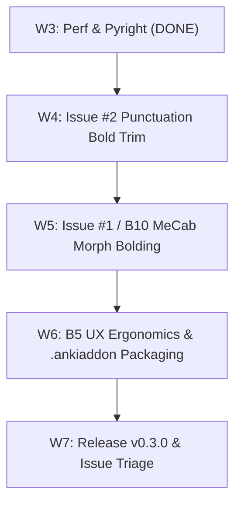

# Mining Fixer — Project State & Agent Handoff Guide

> **For incoming agents:** This document is the single source of truth for the project's current state, verified work completed, and exact step-by-step implementation recipes for the remaining workstreams. The application is **100% functional, fully verified, and passing all static, unit, and CI gates**.

---

## 1. Quick Verification & Operating Rules

Before touching any code, verify the environment gates:

```bash
ruff check . && ruff format --check . && pyright   # Must be 0 errors, 0 warnings
pytest -ra                                         # 268 passed locally (or python3 -m pytest)
```

Push and CI gate:
```bash
git push origin main
RUN_ID=$(gh run list --workflow=tests.yml --limit 1 --json databaseId --jq '.[0].databaseId')
gh run watch "$RUN_ID" --exit-status
```

### Hard Operating Rules (from [AGENTS.md](file:///home/mohamed/Desktop/Github/anki-mining-fixer/AGENTS.md))
1. **Never write to a live Anki profile from dev tooling.** Work against temporary copies or fixtures.
2. **Never start Anki, Qt, or a web engine on the author's machine.** Booting Anki (including `offscreen` or web engine probes) has previously crashed the author's session. Verify GUI code via `pyright` and import checks (`tests/test_addon_load.py`).
3. **No heavy jobs.** Fast gates only (`ruff`, `pyright`, `pytest`).
4. **The pure core stays pure.** `normalize.py`, `fieldconfig.py`, `matching.py`, `plan.py`, `report.py`, `batch.py`, `applier.py` must never import `anki`, `aqt`, or PyQt (`tests/test_layer_boundary.py` enforces this via AST check).
5. **Never guess.** Ambiguity is reported (`reasons`, `warnings`), never resolved by heuristic guessing.
6. **One Apply is the whole fix; second Apply is a no-op** (`QUALITY.md` Q-A2).
7. **Commit conventions:** Conventional Commits (`feat:`, `fix:`, `perf:`, `chore:`, `docs:`), imperative, with trailers:
   ```text
   Harness: OpenCode
   Model: <Model Name>
   ```

---

## 2. Completed Workstreams (Shipped & CI-Verified)

### Baseline Fixes (`37357b3`, `641ea3c`)
- Fixed `Definition` and `Extended definition` policies: permanently part of `FIELD_NEVER_COPY`; empty `<ol></ol>` shells cleared via `strip_empty_glossary`.
- Hardened `_word_recovered_scene_writes` (`Q-D8`, `Q-D14`, `Q-D16`, `Q-A2`).
- Fixed ruby repair vs. regeneration ordering and wired `PreviewDialog` through `apply_plan_to_fixpoint` with `excluded_keys`.
- Hardened `scripts/restore_corrupted_cards.py` with immutable SQLite dry-run checks.

### Workstream 1: GitHub Repository Governance & Hygiene (`30e3e94`)
- Repository settings updated on remote: `has_wiki=false`, `has_projects=false`, `delete_branch_on_merge=true`.
- Branch protection ruleset `27489457` active on `main` (blocks force-push and deletion while permitting fast-forward push).
- Added `.github/dependabot.yml` for automated GitHub Actions version updates.
- Redacted legacy profile path in `PROJECT_NOTES.md`.
- GitHub release `v0.2.0` tagged and published at commit `641ea3c`.
- Issue labels created (`bug`, `enhancement`, `mecab`, `policy`, `performance`, `packaging`) and applied to open issues `#1`–`#5`.

### Workstream 2: Static Type Safety & Pyright Gate (`e07c856`)
- Resolved all 47 `pyright` diagnostics across `mining_fixer/`, `scripts/`, and `tests/`:
  - Fixed real Qt bug in `preview_dialog.py` and `batch_dialog.py` where `showCritical(..., parent=mw)` passed `QMainWindow` to `parent: QWidget | None`.
  - Added guards for optional Qt headers (`table.verticalHeader()`, `table.horizontalHeader()`) and actions (`menu.addAction()`).
  - Added type narrowing helpers (`_string_list`) in `applier.decide_undo` for arbitrary JSON payloads.
  - Added `pyright` and wheel dependency caching to `.github/workflows/tests.yml`.
  - Configured `[tool.pyright]` in `pyproject.toml` with `extraPaths = ["scripts", "tests"]` and `reportMissingImports = "none"`.

### Workstream 3: Performance Engineering — 275× Speedup (`ffbe1a3`)
- Implemented `SceneParentIndex` in `mining_fixer/matching.py`:
  - Pre-sorts enriched parent timeline once per plan.
  - Builds a 3-gram inverted index over normalized parent sentences.
  - Intersects the rarest 3-character posting list with `[lo, hi)` timestamp window using binary search (`bisect`).
  - Evaluated on dense 4,000-note benchmark: `find_scene_parents` reduced from **21.15s to 0.077s (275× faster)**; full plan generation on 1,000 targets reduced to **0.438s**.
- Accelerated `normalize.kana_fold` with a precomputed `str.maketrans` translation table (`_KANA_FOLD_TABLE`), replacing the per-character generator (~25× faster).
- Optimized consensus calculation in `matching.best_word_source` using `collections.Counter` ($O(K)$ vs $O(K^2)$).
- Cached normalized sentence lookups in `plan.build_plan` and `matching.rank_scene_parents`.
- Added Hypothesis property-based tests proving `SceneParentIndex` is mathematically 100% identical to linear scanning under arbitrary timelines, and proving `kana_fold` matches the codepoint specification.

---

## 3. Remaining Workstreams: Step-by-Step Recipes

The remaining work is divided into 4 self-contained workstreams. Any agent can take them sequentially.



---

### Workstream 4: Punctuation-Wrapped Bold Trim (GitHub Issue #2)

#### Problem
In note `1793112599834` (`とんでもない`), the sentence is:
`とんでもない>大物か,とんでもないバカかのどちらかだな.`
The existing bold wraps `<b>とんでもない></b>` (the word plus a trailing subtitle delimiter `>`). Because `とんでもない` occurs twice in the sentence, `_word_span` refuses to place a new bold due to ambiguity, leaving the ugly `>` inside the bold tags.

#### Implementation Recipe
1. **Document invariant in `QUALITY.md` (`Q-D3`) & `IMPLEMENTATION_PLAN.md` (`T18`)**:
   - State that when an existing `<b>...</b>` span contains leading or trailing non-word punctuation or escaped entities (`>`, `<`, `&gt;`, `&lt;`, commas, quotes, periods), those outer non-word characters are trimmed out of the bold tag:
     `<b>とんでもない></b>` $\to$ `<b>とんでもない</b>>`.
   - Invariant: `strip_renderable(new) == strip_renderable(old)` (strictly markup-only).
   - This applies even when the word occurs multiple times in the sentence, because it preserves the author's existing chosen occurrence while fixing only the tag boundary.
2. **Implement in `mining_fixer/plan.py`**:
   - In `_bold_repair_for(target, rules)`:
     Add a helper `_trim_bold_punctuation(sentence: str, recognized_words: set[str]) -> tuple[str, bool]`:
     ```python
     _BOLD_TRIM_RE = re.compile(r"<b>([^<>]*)</b>")
     # Matches non-word trailing/leading delimiters: [> < . , ! ? : ; 。 、 … ➡] and &gt; &lt;
     ```
     When an existing bold inner string has outer punctuation stripped such that `inner.strip(PUNCT)` is in `recognized_words`, rewrite to `prefix + <b>{core}</b> + suffix`.
   - Return badge `"bold-trimmed-punctuation"`.
3. **Tests**:
   - In `tests/test_plan.py`, add unit test for note `1793112599834` (`とんでもない>大物か,とんでもないバカかのどちらかだな.` $\to$ `とんでもない</b>>`).
   - Verify second run is a no-op (idempotence).
4. **Git & Issue**:
   - Commit: `fix(plan): trim punctuation from existing bold spans on repeated words (fixes #2)`.
   - Push and verify CI.
   - Close issue #2 via `gh issue close 2 --comment "Resolved in commit <sha>"`.

---

### Workstream 5: Offline MeCab Morphological Bolding (GitHub Issue #1 & Backlog B10)

#### Problem
Issue #1 notes that bold repair fails on inflected forms:
- `淀む` (note `1793400721969`): sentence bolds `<b>よどん</b>だ` (inflected verb `よどん` from lemma `淀む`).
- `日差し` (note `1792501126791`): sentence bolds `<b>日射し</b>` (alternate kanji for reading `ひざし`).

#### Pure Architecture & Engine Seam
1. **Pure Token Protocol in `mining_fixer/normalize.py`**:
   ```python
   @dataclass(frozen=True)
   class MorphToken:
       surface: str
       pos: str
       lemma: str
       reading: str
   ```
2. **Injected seam in `plan.build_plan`**:
   Add `morph_tokenizer: Callable[[str], Sequence[MorphToken]] | None = None` to `build_plan`.
   `plan.py` stays 100% pure Python!
3. **Japanese Support Engine Bridge in `mining_fixer/collection_io.py`**:
   - Japanese Support (`addons21/3918629684`) bundles a complete offline MeCab binary and IPADIC dictionary in `supportDir` (`support/mecab.lin`, `mecab.exe`, `mecab.osx`, `mecabrc`, `dicrc`).
   - Implement `japanese_support_morph_tokenizer()`:
     Spawns a persistent or cached `Popen` with:
     `--node-format=%m\t%f[0]\t%f[6]\t%f[7]\n --unk-format=%m\tUNK\t%m\t\n --eos-format=EOS\n`
     yielding `MorphToken(surface, pos, lemma, reading)`.
4. **Logic in `mining_fixer/plan.py`**:
   - **Recognition**: If a sentence already has `<b>...</b>` (e.g. `<b>よどん</b>`), and `morph_tokenizer` confirms the bolded span has lemma matching `target.get("Expression")` (or reading matching `target.get("reading")`), recognize it as valid bold! Do not flag as foreign or missing.
   - **Placement (Tier 5 / Config key `batch_bold_inflected`)**:
     For unbolded sentences without Tier 1–4 matches, if `batch_bold_inflected` is true (in `config.json`), analyze sentence tokens with `morph_tokenizer`. If **exactly one** content token (`動詞`, `形容詞`, `名詞`) has lemma matching `Expression` (or reading matching when kana-only), wrap that unique surface span in `<b>...</b>` with badge `"bold-added-to-inflected-form"`.
   - Ambiguity rule: If 2+ tokens have the same lemma, emit warning `cloze-word-ambiguous` and refuse to guess.
5. **Tests**:
   - In `tests/test_plan.py`, test with mock `morph_tokenizer` verifying `淀む` $\to$ `<b>よどん</b>` and `日差し` $\to$ `<b>日射し</b>`.
6. **Git & Issue**:
   - Commit: `feat(plan): add offline morphological bolding via Japanese Support MeCab (fixes #1)`.
   - Push, verify CI, and close issue #1.

---

### Workstream 6: UX Ergonomics, Subdecks, & `.ankiaddon` Packaging

#### Part A: UX Ergonomics (Backlog B5)
- In `mining_fixer/report.py`:
  Add pure `guard_explanations(badges: Sequence[str]) -> list[str]` mapping badge strings to clear, human-readable explanations (e.g. `divergent-parents` $\to$ "Sibling cards in this scene disagree on audio/sentence; requires manual check", `stale-fragment-furigana-risk` $\to$ "Sentence expansion would leave an outdated ruby annotation").
- In `mining_fixer/preview_dialog.py`:
  - Show these explanations in a tooltip or row details panel.
  - Add a quick filter bar (`QLineEdit`) above the table to search rows by Expression or badge.

#### Part B: Subdeck & Selection-Deck Sources
- In `mining_fixer/collection_io.py`:
  - Update `deck_records`: if `col.decks.deck_and_child_ids` exists, load cards from child subdecks as well.
  - In `plan_preview`: if notes are selected across multiple decks in the Browser, load all matching note-type cards from those decks as potential sources.
  - Unit tests in `tests/test_addon_load.py` or `tests/test_notify_collection_changed.py`.

#### Part C: Packaging Script (Backlog B3)
- Create `scripts/build_ankiaddon.py`:
  - Reads `manifest.json` and `pyproject.toml` version.
  - Compiles a zip archive `dist/mining_fixer-<version>.ankiaddon`.
  - Invariants:
    - Root of zip contains `manifest.json` and `__init__.py`.
    - Excludes `meta.json`, `user_files/`, `__pycache__/`, `*.pyc`, `*.git*`.
- Add `tests/test_packaging.py` to test archive generation and structural invariants.
- Add release artifact step to `.github/workflows/tests.yml` or a new release workflow on tag push.

---

### Workstream 7: Release `v0.3.0`, Docs Sync, & Issue Triage

1. **Version Bump**:
   - Bump version to `0.3.0` in `mining_fixer/manifest.json` and `pyproject.toml`.
2. **Docs Synchronization**:
   - Update `PRODUCT.md`, `MVP.md`, `ARCHITECTURE.md`, `QUALITY.md`, `TEST_STRATEGY.md`, `IMPLEMENTATION_PLAN.md`, `README.md`.
   - Ensure test counts (`pytest` passed count) match reality.
3. **Release & Tagging**:
   - Run `python3 scripts/build_ankiaddon.py`.
   - Commit: `chore(release): bump version to 0.3.0`.
   - Push to `origin/main`.
   - Tag `v0.3.0`: `git tag -a v0.3.0 -m "Release v0.3.0" && git push origin v0.3.0`.
   - Create GitHub Release:
     ```bash
     gh release create v0.3.0 dist/mining_fixer-0.3.0.ankiaddon --title "v0.3.0" --notes "..."
     ```
4. **Issue Triage Notes**:
   - Issues #1 & #2: Closed by W4 & W5.
   - Issues #3 (`自負`), #4 (`今回...`), #5 (`倍にして`): Post detailed architectural policy comments explaining the design rationale and resolution roadmap.

---

## 4. Key Reference Files & Functions

| Function / Symbol | File Location | Purpose |
|---|---|---|
| `SceneParentIndex` | [matching.py](file:///home/mohamed/Desktop/Github/anki-mining-fixer/mining_fixer/matching.py) | 3-gram index and fast window intersection |
| `find_scene_parents` | [matching.py](file:///home/mohamed/Desktop/Github/anki-mining-fixer/mining_fixer/matching.py) | Windowed parent containment lookup |
| `_bold_repair_for` | [plan.py](file:///home/mohamed/Desktop/Github/anki-mining-fixer/mining_fixer/plan.py) | Bold cloze candidate matching & repair |
| `_single_bold` | [plan.py](file:///home/mohamed/Desktop/Github/anki-mining-fixer/mining_fixer/plan.py) | Wraps exactly one bold span around target |
| `build_plan` | [plan.py](file:///home/mohamed/Desktop/Github/anki-mining-fixer/mining_fixer/plan.py) | Top-level pure planning entry point |
| `japanese_support_furigana_generator` | [collection_io.py](file:///home/mohamed/Desktop/Github/anki-mining-fixer/mining_fixer/collection_io.py) | Bridge to Japanese Support MeCab reading engine |
| `notify_collection_changed` | [collection_io.py](file:///home/mohamed/Desktop/Github/anki-mining-fixer/mining_fixer/collection_io.py) | UI / Browser DOM post-write synchronization |
