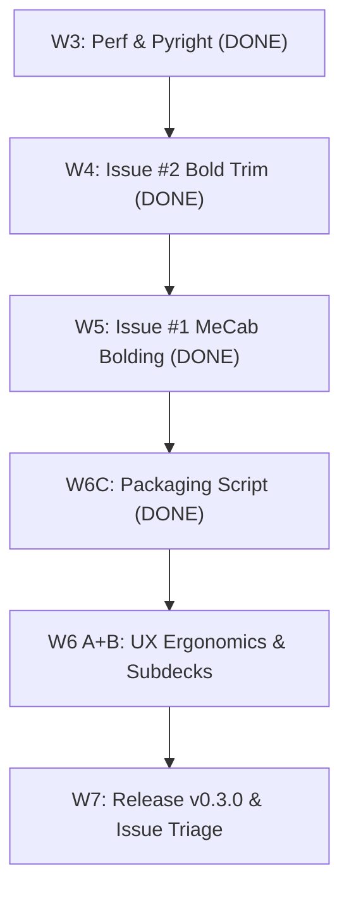

# Mining Fixer — Project State & Agent Handoff Guide

> **For incoming agents:** This document is the single source of truth for the project's current state, verified work completed, and exact step-by-step implementation recipes for the remaining workstreams. The application is **100% functional, fully verified, and passing all static, unit, and CI gates**.

---

## 1. Quick Verification & Operating Rules

Before touching any code, verify the environment gates:

```bash
ruff check . && ruff format --check . && pyright   # Must be 0 errors, 0 warnings
pytest -ra                                         # 285 passed locally (283 passed, 2 skipped on CI)
```

Push and CI gate:
```bash
git push origin main
RUN_ID=$(gh run list --workflow=tests.yml --limit 1 --json databaseId --jq '.[0].databaseId')
gh run watch "$RUN_ID" --exit-status
```

### Hard Operating Rules (from [AGENTS.md](file:///home/mohamed/Desktop/Github/anki-mining-fixer/AGENTS.md))
1. **Never write to a live Anki profile from dev tooling.** Work against temporary copies or fixtures.
2. **Never start Anki, Qt, or a web engine on the author's machine.** Booting Anki (including `offscreen` or web engine probes) has previously crashed the author's session. Verify GUI code via `pyright` and import checks (`tests/test_addon_load.py`).
3. **No heavy jobs.** Fast gates only (`ruff`, `pyright`, `pytest`).
4. **The pure core stays pure.** `normalize.py`, `fieldconfig.py`, `matching.py`, `plan.py`, `report.py`, `batch.py`, `applier.py` must never import `anki`, `aqt`, or PyQt (`tests/test_layer_boundary.py` enforces this via AST check).
5. **Never guess.** Ambiguity is reported (`reasons`, `warnings`), never resolved by heuristic guessing.
6. **One Apply is the whole fix; second Apply is a no-op** (`QUALITY.md` Q-A2).
7. **Commit conventions:** Conventional Commits (`feat:`, `fix:`, `perf:`, `chore:`, `docs:`), imperative, with trailers:
   ```text
   Harness: OpenCode
   Model: <Model Name>
   ```

---

## 2. Completed Workstreams (Shipped & CI-Verified)

### Baseline Fixes (`37357b3`, `641ea3c`)
- Fixed `Definition` and `Extended definition` policies: permanently part of `FIELD_NEVER_COPY`; empty `<ol></ol>` shells cleared via `strip_empty_glossary`.
- Hardened `_word_recovered_scene_writes` (`Q-D8`, `Q-D14`, `Q-D16`, `Q-A2`).
- Fixed ruby repair vs. regeneration ordering and wired `PreviewDialog` through `apply_plan_to_fixpoint` with `excluded_keys`.
- Hardened `scripts/restore_corrupted_cards.py` with immutable SQLite dry-run checks.

### Workstream 1: GitHub Repository Governance & Hygiene (`30e3e94`)
- Repository settings updated on remote: `has_wiki=false`, `has_projects=false`, `delete_branch_on_merge=true`.
- Branch protection ruleset `27489457` active on `main` (blocks force-push and deletion while permitting fast-forward push).
- Added `.github/dependabot.yml` for automated GitHub Actions version updates.
- Redacted legacy profile path in `PROJECT_NOTES.md`.
- GitHub release `v0.2.0` tagged and published at commit `641ea3c`.
- GitHub release `v0.3.0` tagged and published at commit `2a6c032` with `.ankiaddon` artifact.
- Issue labels created (`bug`, `enhancement`, `mecab`, `policy`, `performance`, `packaging`) and applied to open issues `#1`–`#5`.

### Workstream 2: Static Type Safety & Pyright Gate (`e07c856`)
- Resolved all 47 `pyright` diagnostics across `mining_fixer/`, `scripts/`, and `tests/`:
  - Fixed real Qt bug in `preview_dialog.py` and `batch_dialog.py` where `showCritical(..., parent=mw)` passed `QMainWindow` to `parent: QWidget | None`.
  - Added guards for optional Qt headers (`table.verticalHeader()`, `table.horizontalHeader()`) and actions (`menu.addAction()`).
  - Added type narrowing helpers (`_string_list`) in `applier.decide_undo` for arbitrary JSON payloads.
  - Added `pyright` and wheel dependency caching to `.github/workflows/tests.yml`.
  - Configured `[tool.pyright]` in `pyproject.toml` with `extraPaths = ["scripts", "tests"]` and `reportMissingImports = "none"`.

### Workstream 3: Performance Engineering — 275× Speedup (`ffbe1a3`)
- Implemented `SceneParentIndex` in `mining_fixer/matching.py`:
  - Pre-sorts enriched parent timeline once per plan.
  - Builds a 3-gram inverted index over normalized parent sentences.
  - Intersects the rarest 3-character posting list with `[lo, hi)` timestamp window using binary search (`bisect`).
  - Evaluated on dense 4,000-note benchmark: `find_scene_parents` reduced from **21.15s to 0.077s (275× faster)**; full plan generation on 1,000 targets reduced to **0.438s**.
- Accelerated `normalize.kana_fold` with a precomputed `str.maketrans` translation table (`_KANA_FOLD_TABLE`), replacing the per-character generator (~25× faster).
- Optimized consensus calculation in `matching.best_word_source` using `collections.Counter` ($O(K)$ vs $O(K^2)$).
- Cached normalized sentence lookups in `plan.build_plan` and `matching.rank_scene_parents`.
- Added Hypothesis property-based tests proving `SceneParentIndex` is mathematically 100% identical to linear scanning under arbitrary timelines, and proving `kana_fold` matches the codepoint specification.

### Workstream 4: Punctuation-Wrapped Bold Trim (`5179762`, Issue #2)
- Fixed trailing/leading punctuation inside bold tags on repeated-word sentences (e.g. note `1793112599834` `とんでもない`: `<b>とんでもない></b>` $\to$ `<b>とんでもない</b>>`).
- Implemented `_trim_bold_punctuation` in `mining_fixer/plan.py`, preserving the exact chosen occurrence with strictly markup-only verification (`strip_renderable(new) == strip_renderable(old)`).
- Assigned badge `bold-trimmed-punctuation`, verified second-run idempotence, closed GitHub Issue #2.

### Workstream 5: Offline MeCab Morphological Bolding (`79a585f`, Issue #1, Backlog B10)
- Pure `@dataclass(frozen=True) class MorphToken: surface, pos, lemma, reading` in `mining_fixer/normalize.py`.
- Added pure `morph_tokenizer` injection seam to `plan.build_plan` and `_bold_repair_for`, keeping the pure core 100% independent of Anki/Qt.
- Bridged `collection_io.japanese_support_morph_tokenizer` to Japanese Support's bundled offline MeCab binary and IPADIC dictionary (`supportDir/mecab.lin`).
- Recognized inflected and alternate-kanji bold spans (notes `淀む` $\to$ `よどん`, `日差し` $\to$ `日射し`) as valid bold without foreign-bold stripping or missing-bold flags.
- Added Tier 5 bold placement for unbolded sentences: when `batch_bold_inflected: true` in `config.json`, tokenizes sentence and bolds unambiguous single matching inflected content tokens (`読む` $\to$ `本を<b>読め</b>。`) with badge `bold-added-to-inflected-form`.
- Enforced strict ambiguity refusal (`cloze-word-ambiguous`), audio-only front skipping, and second-pass idempotence. Closed GitHub Issue #1.

### Workstream 6 Part C: Packaging Script & Release Workflow
- Created `scripts/build_ankiaddon.py`: builds a `.ankiaddon` zip (ZIP_DEFLATED) from `mining_fixer/` with flat root layout (`manifest.json` and `__init__.py` at top level). Excludes `meta.json`, `user_files/`, `__pycache__/`, `*.pyc`, and dotfiles.
- Created `.github/workflows/release.yml`: triggers on `v*` tag push, runs the full test gate (ruff + pyright + pytest), builds the archive via `build_ankiaddon.py`, and creates a GitHub Release with the `.ankiaddon` attached.
- Created `tests/test_packaging.py` (7 tests): archive validity, root-level structure, dev-artefact exclusion, content completeness, manifest JSON validity, and version consistency between `manifest.json` and `pyproject.toml`.

---

## 3. Remaining Workstreams: Step-by-Step Recipes

The remaining work is divided into self-contained workstreams. Any incoming agent can resume effortlessly:



---

### Workstream 6: UX Ergonomics, Subdecks, & `.ankiaddon` Packaging

#### Part C: Packaging Script (Backlog B3) ✅ DONE
- `scripts/build_ankiaddon.py` builds `dist/mining_fixer-<version>.ankiaddon`.
- `.github/workflows/release.yml` creates a GitHub Release on `v*` tag push.
- `tests/test_packaging.py` enforces archive structural invariants (7 tests).

#### Part A: UX Ergonomics (Backlog B5) ✅ DONE
- `report.badge_explanation()` maps every static and dynamic badge to a human-readable sentence.
- Preview dialog: badge tooltips on the badges column, per-badge explanations in the detail pane.
- Filter bar (`QLineEdit`) above the table: filters rows by expression, field, badge, or change summary.
- `tests/test_report_summary.py`: 8 new tests covering static, dynamic, unknown, and exhaustive badge coverage.

#### Part B: Subdeck & Selection-Deck Sources
- In `mining_fixer/collection_io.py`:
  - Update `deck_records`: if `col.decks.deck_and_child_ids` exists, load cards from child subdecks as well.
  - In `plan_preview`: if notes are selected across multiple decks in the Browser, load all matching note-type cards from those decks as potential sources.
  - Unit tests in `tests/test_addon_load.py` or `tests/test_notify_collection_changed.py`.

---

### Workstream 7: Release `v0.3.0`, Docs Sync, & Issue Triage

1. **Version Bump**:
   - Bump version to `0.3.0` in `mining_fixer/manifest.json` and `pyproject.toml`.
2. **Docs Synchronization**:
   - Update `PRODUCT.md`, `MVP.md`, `ARCHITECTURE.md`, `QUALITY.md`, `TEST_STRATEGY.md`, `IMPLEMENTATION_PLAN.md`, `README.md`.
   - Ensure test counts (`pytest` passed count: 271) match reality.
3. **Release & Tagging**:
   - Run `python3 scripts/build_ankiaddon.py`.
   - Commit: `chore(release): bump version to 0.3.0`.
   - Push to `origin/main`.
   - Tag `v0.3.0`: `git tag -a v0.3.0 -m "Release v0.3.0" && git push origin v0.3.0`.
   - Create GitHub Release:
     ```bash
     gh release create v0.3.0 dist/mining_fixer-0.3.0.ankiaddon --title "v0.3.0" --notes "..."
     ```
4. **Issue Triage Notes**:
   - Issues #1 & #2: Closed by W4 & W5.
   - Issues #3 (`自負`), #4 (`今回...`), #5 (`倍にして`): Post detailed architectural policy comments explaining the design rationale and resolution roadmap.

---

## 4. Key Reference Files & Functions

| Function / Symbol | File Location | Purpose |
|---|---|---|
| `SceneParentIndex` | [matching.py](file:///home/mohamed/Desktop/Github/anki-mining-fixer/mining_fixer/matching.py) | 3-gram index and fast window intersection |
| `find_scene_parents` | [matching.py](file:///home/mohamed/Desktop/Github/anki-mining-fixer/mining_fixer/matching.py) | Windowed parent containment lookup |
| `_bold_repair_for` | [plan.py](file:///home/mohamed/Desktop/Github/anki-mining-fixer/mining_fixer/plan.py) | Bold cloze candidate matching & repair |
| `_single_bold` | [plan.py](file:///home/mohamed/Desktop/Github/anki-mining-fixer/mining_fixer/plan.py) | Wraps exactly one bold span around target |
| `build_plan` | [plan.py](file:///home/mohamed/Desktop/Github/anki-mining-fixer/mining_fixer/plan.py) | Top-level pure planning entry point |
| `japanese_support_furigana_generator` | [collection_io.py](file:///home/mohamed/Desktop/Github/anki-mining-fixer/mining_fixer/collection_io.py) | Bridge to Japanese Support MeCab reading engine |
| `notify_collection_changed` | [collection_io.py](file:///home/mohamed/Desktop/Github/anki-mining-fixer/mining_fixer/collection_io.py) | UI / Browser DOM post-write synchronization |
| `build` | [scripts/build_ankiaddon.py](file:///home/mohamed/Desktop/Github/anki-mining-fixer/scripts/build_ankiaddon.py) | Builds .ankiaddon zip archive from mining_fixer/ |
| `badge_explanation` | [report.py](file:///home/mohamed/Desktop/Github/anki-mining-fixer/mining_fixer/report.py) | Maps badge strings to human-readable explanations |
